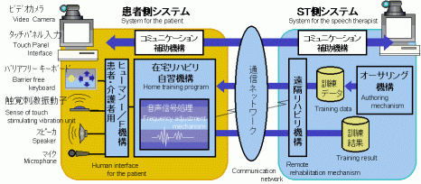

# Kazunari Kamata

インフラ運用、EOL対応、基盤更改、クラウド移行、Windows端末運用、レガシーWebシステム保守、社内SE業務、ユーザーサポート、運用改善に加え、フロントエンド／バックエンドのアプリケーション開発にも取り組んでいます。実務的なツール、検証記録、ドキュメントとともに、TypeScript・React・Vue・Node.js・Go・Rust を用いたコーディングの成果をまとめたプロフィールリポジトリです。

## Featured Projects

### Application Development

フロントエンドと API を含む Web アプリケーションから、Rust 製 CLI とその検証用サンプルまで、実装・テスト・ドキュメント整備を一貫して行っています。

#### go2rust-cli

Go ソースコードを Rust ソースコードの雛形へ変換する Rust 製 CLI です。完全変換ではなく、対応済み構文の初期変換と未対応構文の TODO コメント出力を目的にしています。

#### go2rust-cli-samples

`go2rust-cli` の変換入力として使う Go サンプル集です。対応済み・未対応の構文を小さなコードで検証し、CLI の変換結果を継続的に確認しています。

#### next-nuxt-learning-sample

Next.js（React）と Nuxt（Vue）で同一の CRUD タスクアプリを比較する TypeScript 学習モノレポです。フロントエンド UI と Next Route Handler／Nuxt Nitro Handler によるバックエンド API を実装し、型検査、ユニットテスト、E2E テスト、デバッグ、CI まで扱っています。

### Infra Lifecycle Portal

インフラ資産のEOLリスク、移行優先度、検証観点、ロールバック手順を整理するための軽量なライフサイクル管理ツールです。

### internal-se-ops-kit

社内SE業務で発生しやすい入退社、アカウント管理、端末管理、インシデント対応、変更申請を整理するための運用テンプレート集です。

### pm-pmo-ops-kit

PM・PMOが要件定義からプロジェクト終結までに使う、工程別の文書・会議・管理台帳のテンプレート集です。工程ゲート、RAID・変更管理、意思決定、進捗報告に加え、Mermaidによるプロジェクトフローとガントチャートを含みます。

### qa-ops-kit

QA・テスト業務向けのテンプレート集です。単体・結合・総合・受け入れテストの計画、テストケース、障害管理、品質報告、リリース判定に加え、MermaidによるQAライフサイクルとテストレベルのフローを含みます。

### security-ops-kit

脆弱性診断・トリアージ、インシデント対応、再発防止、SLA/SLO、資産・特権アクセス・委託先評価をPDCAで運用するためのセキュリティテンプレート集です。

### Remote Rehabilitation System Support

医療・福祉分野の在宅リハビリテーション支援システムの実証において、患者側／医療スタッフ側システムの環境構築と接続支援を担当しました。音声コミュニケーションを用いた遠隔リハビリテーションを、機器・ネットワークの運用面から支えました。

病院と患者宅を PC ネットワークで接続し、在宅での訓練と遠隔での支援を行う実証に関わりました。

### Community Platform Operations and Medical IT Support

障害のある方・家族・福祉関係者・ボランティアをつなぐオンラインコミュニティのサイト運用を担当しました。会員サポート、ネットワーク／メール環境の運用、コンテンツ更新を通じて、サービスの継続的な利用を支援しました。

あわせて医療機関に対し、PC とソフトウェアの設置、初期設定、保守、利用時の問い合わせ対応を実施しました。

### Internet Service Provider Support

インターネット接続サービスのプロバイダーにおいて、利用者のインターネット接続設定とトラブルシューティングを担当しました。不正アクセスの被害を受けた利用者には、状況確認、初期対応、アカウント・接続環境の復旧支援を行いました。

### Portfolio Site

公開リポジトリや技術的な取り組みを整理して掲載するGitHub Pagesサイトです。

## Skills

### Infrastructure / OS Operations

Linux / Unix 系 OS、Windows、ネットワーク、DNS、VPN、プロキシ、パッケージ管理、仮想化、運用手順化を中心に扱っています。

### Windows / Endpoint Operations

Windows 端末の基本運用、PowerShell / CMD による確認・自動化、winget / Chocolatey / Scoop などのパッケージ管理、WSL / Hyper-V まわりの検証、Intune / Entra ID を前提にした端末登録・権限整理、時刻同期や Sysprep を含む端末ライフサイクルの観点を扱っています。

### Technical Support / Internal IT

ユーザーからの問い合わせ対応、一次切り分け、インシデント対応、アカウント・端末に関する支援、手順書・ナレッジの整備に取り組んでいます。調査結果を関係者へ共有し、再発防止や運用改善につなげることを重視しています。

遠隔リハビリテーションの実証では、患者側・医療スタッフ側の PC、周辺機器、ネットワーク接続を整備し、音声コミュニケーション環境の構築・接続支援を担当しました。

オンラインコミュニティでは、サイトとコンテンツの運用、会員サポート、ネットワーク／メール環境の運用を担当しました。医療機関に対しては、PC・ソフトウェアの設置、初期設定、保守、問い合わせ対応を行いました。

インターネット接続サービスでは、接続設定の支援、接続トラブルの切り分け、不正アクセス被害時の初期対応と復旧支援を担当しました。

### Cloud / Platform

AWS、Azure、Google Cloud、Docker、Kubernetes、Terraform、Ansible などを使った基盤検証・構築・運用改善に取り組んでいます。

### Backend / Automation / Data

Python、Go、Rust、Node.js、PHP、Perl、シェルスクリプト、データベース、API 連携を用いた自動化や検証ツールを扱っています。

### Application Development

TypeScript／React／Vue による画面実装と、Next.js Route Handler／Nuxt Nitro Handler などを使った API 実装の両方に取り組んでいます。Rust 製 CLI の開発、Go の検証用コード作成、型検査・ユニットテスト・E2E テスト・CI を含め、設計から実装、検証、ドキュメント化まで対応します。

### Legacy Web / CMS Operations

PHP / Perl ベースの既存Webシステム、CMS、フレームワーク、テンプレートエンジン、依存関係管理、テスト整備を運用・保守の観点で扱っています。Composer / PHPUnit、CakePHP、CodeIgniter、WordPress、Drupal、Smarty、CPAN / cpanm、Catalyst、PerlMagick など、古い構成を含む環境の調査、更新計画、移行時の確認観点を整理しています。

### Frontend / Documentation / Tooling

TypeScript、React、Vue、HTML/CSS、Markdown によるドキュメント整備、ポートフォリオ、軽量な管理 UI を作成しています。

### Focus Areas

- インフラ運用
- Windows端末運用
- PowerShell / CMD による運用自動化
- winget / Chocolatey / Scoop によるパッケージ管理
- WSL / Hyper-V 検証
- Intune / Entra ID 端末管理
- EOL対応
- 基盤更改
- クラウド移行・検証
- コンテナ基盤
- IaC / 構成管理
- PHP / Perl 既存システム保守
- Composer / PHPUnit / CPAN まわりの依存関係整理
- WordPress / Drupal などの CMS 運用
- CakePHP / CodeIgniter などのフレームワーク調査
- ネットワーク / DNS / VPN
- セキュリティ・認証まわり
- 社内SE業務テンプレート
- PM / PMO向けのプロジェクト運営テンプレート
- 要件定義・計画・進捗・RAID・変更管理
- Mermaidによるプロジェクトフロー・ガントチャート
- QA・テスト計画・テスト設計
- 単体・結合・総合・受け入れテスト
- 障害管理・品質報告・リリース品質判定
- セキュリティ運用・脆弱性管理・インシデント対応
- SLA / SLO・特権アクセスレビュー・セキュリティ演習
- ユーザーサポート・問い合わせ対応
- 障害一次切り分け・エスカレーション
- アカウント・端末の利用支援
- 手順書・ナレッジベース整備
- 音声コミュニケーションを用いた遠隔支援環境の構築
- 医療・福祉分野の実証システムにおける機器・ネットワーク支援
- Webサイト運用・コンテンツ更新
- 会員サポート・メール環境の運用
- 医療機関向け PC・ソフトウェアの導入・保守
- インターネット接続設定・接続トラブル対応
- 不正アクセス被害時の初期対応・復旧支援
- 運用改善
- 検証観点整理
- Runbook整備
- GitHub Actions による自動化
- フロントエンド開発（TypeScript / React / Vue）
- バックエンド API 開発（Next.js Route Handler / Nuxt Nitro Handler）
- Rust / Go による CLI・検証コード開発
- 型検査・ユニットテスト・E2E テスト

## GitHub Stats

## Profile Summary

## GitHub Trophy

## Contribution Snake

<picture>
  <source media="(prefers-color-scheme: dark)" srcset="https://raw.githubusercontent.com/kazunari-kamata/kazunari-kamata/output/github-snake-dark.svg" />
  <source media="(prefers-color-scheme: light)" srcset="https://raw.githubusercontent.com/kazunari-kamata/kazunari-kamata/output/github-snake.svg" />
  
</picture>
